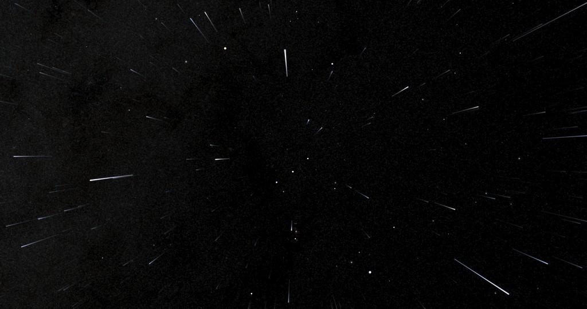
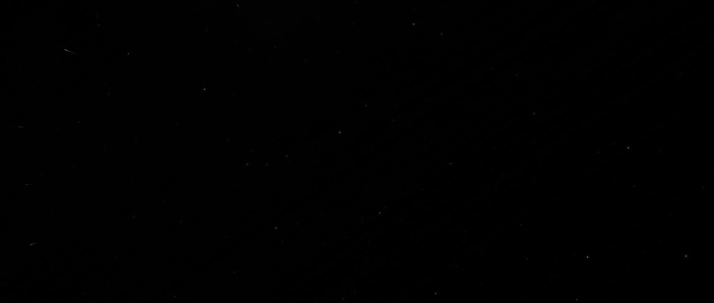
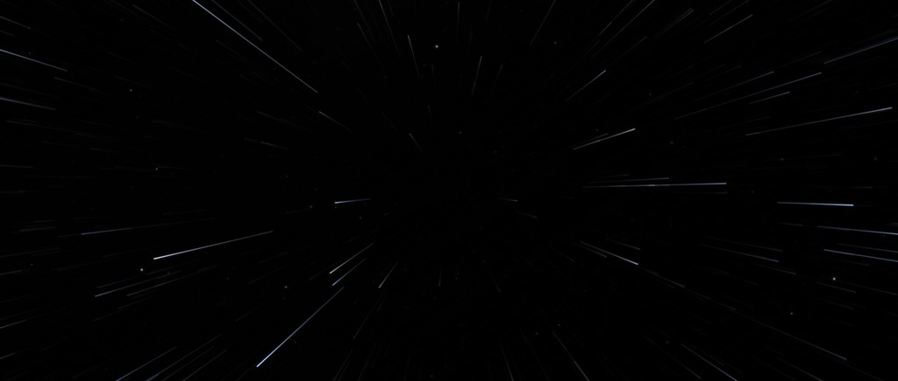
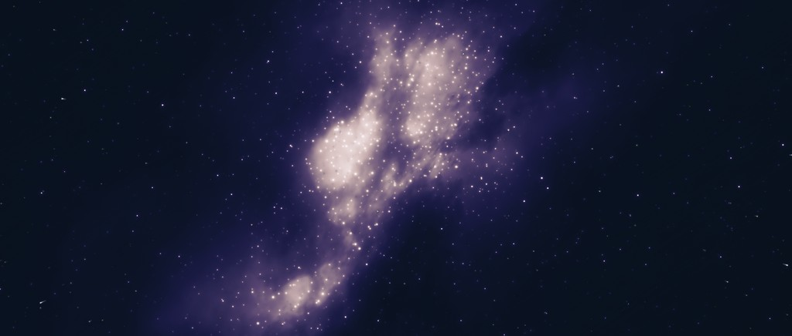
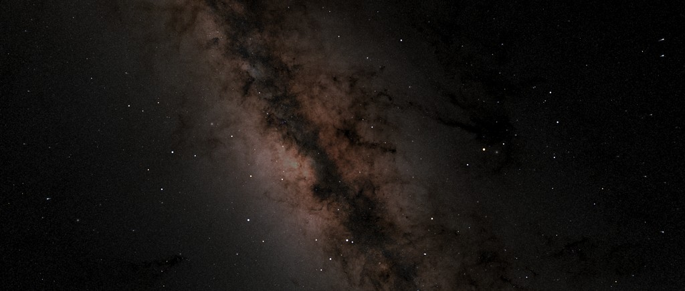
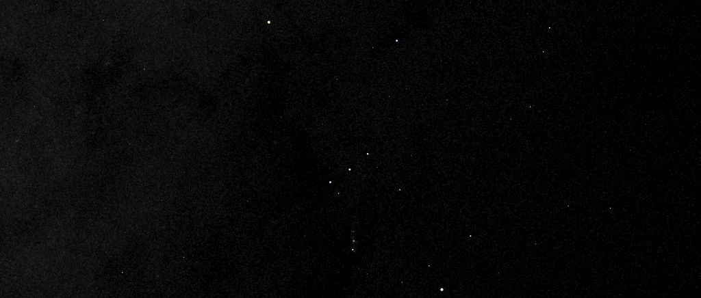
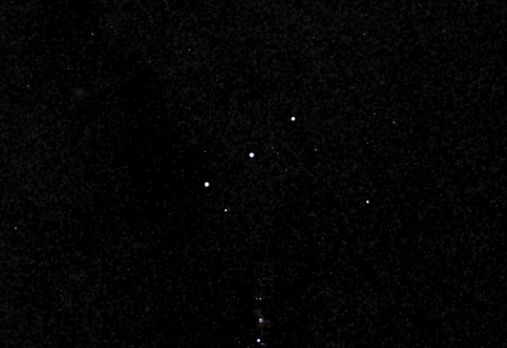

# StarField 開発版（After Effects・Windows）

After Effects の中で、星空と、宇宙空間を進むときの星の流れを描くプラグインの開発版です。
GLSL シェーダーで描き、AE の 3D カメラ（位置・向き・画角）にそのまま連動します。

Over Ray Studio 青木 隆

## ダウンロード

- **右の「Releases」→ いちばん上の版 → `StarField_dev_<版>_win_<日付>.zip`**（中は StarField フォルダ 1 つ）
- または、このページの「Code」→「Download ZIP」（中身は同じ並び）

展開したフォルダの中の並び（plugin・jsx・catalog・samples とシェーダー）は変えずに使ってください。
入れ方・使い方の詳しい説明は **README.txt** にあります。

## できること

3 枚のレイヤーを重ねて、奥行きのある星空を作ります。スクリプト 1 本（`jsx/StarField_Setup_v2.jsx`）で、カメラと一緒に全部できあがります。

| レイヤー | 中身 | カメラとの関係 |
|---|---|---|
| **SF_dome** | 遠くの星空（星の位置は作り物・天の川つき） | 向きと画角だけに追従（無限遠＝視差なし） |
| **SF_dome_real** | **本物の空**（地球から見た実際の星と天の川） | 同上。SF_dome と入れ替えて使う |
| **SF_mid** | 中景の星の流れ | 前に進むと消失点から流れる（視差あり・流れの長さを調整） |
| **SF_near** | カメラの近くを流れる極小の浮遊物 | 近い物ほど速く流れる |

量・大きさ・明るさ・流れの長さ・色・天の川の向きなどは、各レイヤーの StarField エフェクトのつまみで変えられます（キーも打てます）。

## 見本（samples/StarField_samples.aep）

設定違いのコンポが 4 つ入っています（2048×872・24fps・6 秒・16bpc）。

| | |
|---|---|
|  |  |
| **SF01_orbit** 通常露出の宇宙の回り込み。前進しながら向きを左右に振る | **SF02_cruise** 航行中のスターフィールド。向きは固定で前進 |
|  |  |
| **SF03_milkyway** 増感して天の川を見せる。AE 標準のエフェクトで紺とすみれ色に彩色 | **SF04_realsky** 本物の空。いて座の銀河中心を正面に。彩色なし |

## 本物の空（SF_dome_real）

- 星 = **Hipparcos 星表の 117,955 星**。実際の位置・明るさ（等級）・色（B−V から黒体の色）。北が上・東が左の、地球から見た向きです
- 天の川 = **NASA の全天の天の川の地図（Deep Star Maps 2020）**。暗黒帯の形まで実物どおりです
- `view_ra`・`view_dec`（赤経・赤緯）で、空のどこをカメラの正面にするかを決めます。`view_roll` で空を回せます

**仕組み**: 星は「全天の絵を貼る」のではなく、星表のデータを画像（8192×4096・1 画素 = 1 星・中身は等級と色）に詰めてプラグインに渡し、カメラに映っている範囲の星だけを、描くその場で設定どおりの大きさ・明るさの点として描いています。どの画角でも星が甘くなりません。明るさ・明るい星と暗い星の差・明るい星の大きさ・何等星まで描くか・色の濃さは、つまみでその場で変わります。天の川は広がった光なので、地図の画像をカメラの向きで引いています。

*等倍の切り出し。三つ星と、その下のオリオン大星雲（天の川の地図に写っている）*

## 動作確認

- Windows 11・After Effects 2025（25.6）・8bpc／16bpc（32bpc ではメモリが足りなくなって落ちることがあります）
- macOS・After Effects 2025 でも同じ絵になることを確かめています（配布は Windows 版のみ）

## 注意

- 開発中の版です。こまめに保存してください。レンダリングする機械にもプラグインを入れてください
- プラグインにはまだ署名がありません。Windows の「スマート アプリ コントロール」がオンの PC では読み込めないことがあります（README.txt）

## 版

| 版 | 日付 | 中身 |
|---|---|---|
| v0.1.4 | 2026-10-24 | 本物の空（SF_dome_real）を追加・見本に SF04 を追加・プラグインの画像入力と 16bpc の直し |

新しい版はここに足し、Releases にも置きます。

## クレジット・ライセンス

CREDITS.txt・LICENSE.txt・LICENSE_tweak_shader.txt

- プラグインは [Tweak Shader AE](https://github.com/mobile-bungalow/tweak_shader_ae_plugin)（mobile-bungalow・MIT）の改造版です
- 星のデータ: The Hipparcos and Tycho Catalogues, ESA SP-1200 (1997)・CDS VizieR I/239
- 天の川: NASA/Goddard Space Flight Center Scientific Visualization Studio, Deep Star Maps 2020（パブリックドメイン）・Gaia DR2: ESA/Gaia/DPAC
